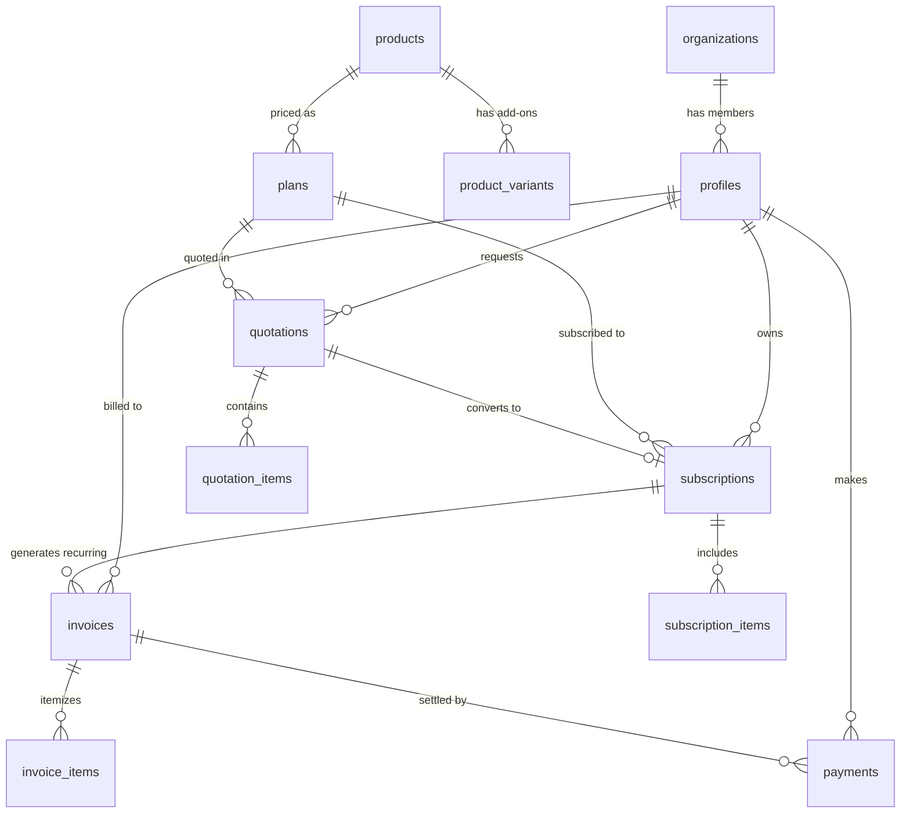

# Brightloop Database Schema Documentation

**Version:** 1.1.0 (Hardened Production Schema)  
**Migration File:** `supabase/migrations/20261031121000_initial_schema.sql`  
**Engine:** PostgreSQL (Supabase)  
**Security Model:** Row Level Security (RLS) on all tables, restricted function execution, empty `search_path`, server-authoritative financials.

---

## 1. Architectural Overview & Entity-Relationship Model



---

## 2. Hardened Security & RBAC Model

### 2.1 Role Definitions
The system strictly enforces three distinct roles in `public.profiles`:

| Role | Access Scope | Privilege Level |
| :--- | :--- | :--- |
| **`admin`** | Complete system access, organization configuration, staff role promotions, database management | Highest |
| **`staff`** | Operational access to products, plans, quotations, subscriptions, invoices, and customer support | Internal Operations |
| **`customer`** | Self-service access strictly scoped to their own records (`auth.uid() = customer_id`) | End-User (Default) |

### 2.2 Privilege Escalation Protections
1. **Public Signup Hardening (`on_auth_user_created`)**:
   - `SECURITY DEFINER` function `handle_new_user()` with `SET search_path = ''`.
   - Forces `role = 'customer'` unconditionally, ignoring any metadata sent in client registration payloads.
2. **Safe Profile Updates Only (`trg_validate_profile_update`)**:
   - Customers can **only** edit safe display fields: `full_name`, `avatar_url`, `phone`, `billing_address`.
   - Any attempt by a customer to alter `role`, `organization_id`, `email`, or `metadata` throws a hard PostgreSQL exception (`Access Denied`).
3. **First-Admin Bootstrap (`bootstrap_first_admin(target_email)`)**:
   - Function is restricted to `service_role` and `postgres` DBA roles (revoked from `PUBLIC`, `anon`, and `authenticated`).
   - Sets a transaction-scoped flag `brightloop.allow_bootstrap` allowing it to bypass the profile-update validation trigger while guaranteeing that `role = 'admin'` can only be granted when exactly 0 admins exist in the database.
   - Automatically aborts with an exception if an administrator already exists.
4. **Staff Management (`set_user_role(target_user_id, new_role)`)**:
   - Requires caller to be an active `admin` (`public.is_admin() = true`). Validates permitted roles (`admin`, `staff`, `customer`).

---

## 3. Financial Integrity & Ownership Verification

### 3.1 Server-Authoritative Quotations & Payments
- **No Direct Customer `UPDATE` on Quotations**: Customers cannot tamper with prices, discounts, line items, or totals.
  - Acceptance/rejection is executed via secure RPCs: `public.accept_quotation(id)` and `public.reject_quotation(id, reason)`.
  - The RPC verifies caller ownership (`customer_id = auth.uid()`), checks expiration date against `NOW()`, and verifies `status = 'sent'`.
- **No Direct Customer `INSERT` on Payments**: Customers cannot forge payment receipts or insert self-confirmed transactions.
  - Payments are created strictly by verified backend payment handlers (webhooks/server actions) using `service_role` or authorized staff.
- **Unauthorized `succeeded` Payment Prevention (`trg_validate_payment_transition`)**:
  - Rejects marking a payment `succeeded` unless executed by `service_role` or authorized backend processors with a valid `transaction_reference`.
  - Enforces strict immutability on settled payments: `amount`, `currency`, and `invoice_id` can never be altered once settled, and status can only transition to `refunded`.

### 3.2 Relational Consistency Triggers
- **`trg_validate_subscription_ownership`**: Guarantees that if `quotation_id` is set on a subscription, its `customer_id` matches the quotation's `customer_id`.
- **`trg_validate_invoice_ownership`**: Guarantees that if `subscription_id` is set on an invoice, its `customer_id` matches the subscription's `customer_id`.
- **`trg_validate_payment_ownership`**: Guarantees that a payment's `customer_id` matches the invoice's `customer_id`.

### 3.3 Duplicate-Invoice Prevention
- Unique partial index:
  ```sql
  CREATE UNIQUE INDEX idx_invoices_unique_subscription_period
    ON public.invoices (subscription_id, billing_period_start, billing_period_end)
    WHERE subscription_id IS NOT NULL
      AND billing_period_start IS NOT NULL
      AND billing_period_end IS NOT NULL;
  ```
  Guarantees that recurring billing cron jobs cannot double-invoice a customer for the same billing window.

---

## 4. RLS Permission Matrix

| Table | `anon` | `authenticated (Customer)` | `authenticated (Staff/Admin)` |
| :--- | :--- | :--- | :--- |
| **`profiles`** | None | `SELECT` (self), `UPDATE` (safe fields only) | `SELECT` (all), `UPDATE` (all), `DELETE` (admin only) |
| **`organizations`** | None | `SELECT` (own organization) | `SELECT` (all), `ALL` (admin only) |
| **`products`** | `SELECT` (active) | `SELECT` (active) | `ALL` (active & archived) |
| **`product_variants`**| `SELECT` (active) | `SELECT` (active) | `ALL` |
| **`plans`** | `SELECT` (active) | `SELECT` (active) | `ALL` |
| **`tax_rules`** | None | `SELECT` (active) | `ALL` |
| **`discount_rules`** | None | `SELECT` (active) | `ALL` |
| **`quotations`** | None | `SELECT` (own quotes only) | `ALL` |
| **`quotation_items`**| None | `SELECT` (own quotes only) | `ALL` |
| **`subscriptions`** | None | `SELECT` (own subs only) | `ALL` |
| **`subscription_items`**| None | `SELECT` (own subs only) | `ALL` |
| **`invoices`** | None | `SELECT` (own invoices only) | `ALL` |
| **`invoice_items`** | None | `SELECT` (own invoices only) | `ALL` |
| **`payments`** | None | `SELECT` (own payments only) | `ALL` |
