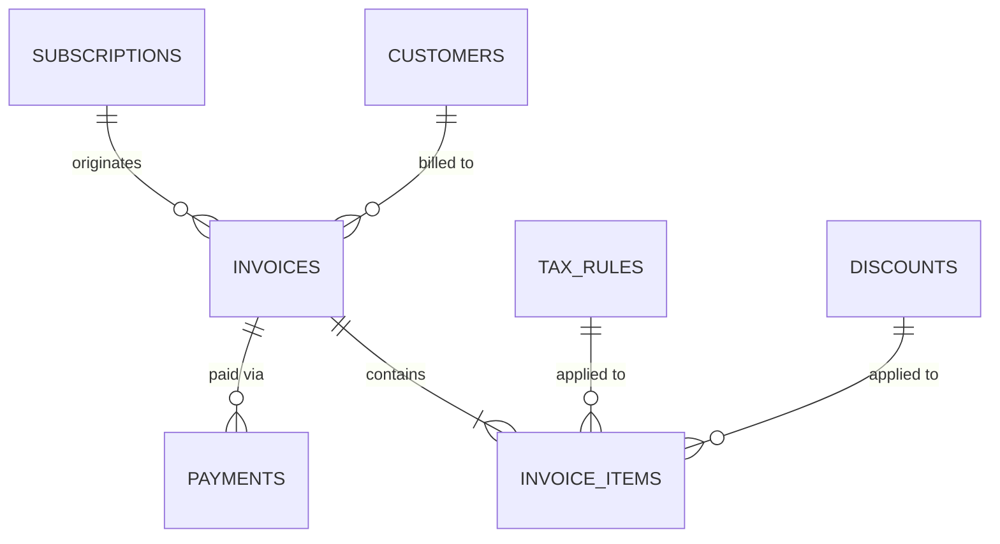

# Brightloop — Billing & Payments Architecture & Contracts

**Owner:** Member 3 — Billing Lead + Quality Assurance  
**Branch:** `feature/billing-payments`  
**Currency:** Indian Rupee (INR - ₹)  
**Arithmetic Precision:** Integer paise (1 INR = 100 paise) to prevent floating-point inaccuracies. Stored as `numeric(12,2)` in PostgreSQL.

---

## 1. Domain Entities & Database Schema

Member 3 owns 5 core entities in PostgreSQL:

1. **`tax_rules`**: Regional/national taxes (e.g. GST 18%, IGST 18%, SGST 9%, CGST 9%, Zero-tax export).
2. **`discounts`**: Promotional coupons & subscription-specific/product-specific discount vouchers (percentage or fixed amount) with usage limits and date validity.
3. **`invoices`**: Financial bills generated from subscriptions or manual orders. Snapshot of customer details, billing period, tax breakdown, and balances.
4. **`invoice_items`**: Line items of an invoice including product snapshot, quantity, unit price, applied discount, and tax calculations.
5. **`payments`**: Payment transaction ledger linked to invoices, tracking manual or gateway payments, partial payments, and settlements.

### Entity Relationship Diagram


---

## 2. Financial Arithmetic & Rounding Policy

To eliminate IEEE 754 floating point inaccuracies:
1. All client and server calculation logic operates in integer **paise** ($1\text{ INR} = 100\text{ paise}$).
2. Sequence:
   - Line Subtotal: $\text{paise} = \text{quantity} \times \text{unit\_price\_paise}$
   - Line Discount:
     - Fixed: $\min(\text{subtotal\_paise}, \text{discount\_paise})$
     - Percentage: $\text{round}\left(\frac{\text{subtotal\_paise} \times \text{discount\_rate}}{100}\right)$
   - Taxable Base: $\text{taxable\_paise} = \max(0, \text{subtotal\_paise} - \text{discount\_paise})$
   - Line Tax: $\text{tax\_paise} = \text{round}\left(\frac{\text{taxable\_paise} \times \text{tax\_rate}}{100}\right)$
   - Line Total: $\text{line\_total\_paise} = \text{taxable\_paise} + \text{line\_tax\_paise}$
3. Invoice Totals:
   - $\text{Invoice Subtotal} = \sum \text{Line Subtotals}$
   - $\text{Invoice Discount Total} = \sum \text{Line Discounts}$
   - $\text{Invoice Tax Total} = \sum \text{Line Taxes}$
   - $\text{Invoice Total Amount} = \sum \text{Line Totals}$
   - $\text{Amount Due} = \text{Total Amount} - \text{Amount Paid}$
4. Overpayment prevention: Server-side validation rejects any payment where $\text{payment\_amount} > \text{amount\_due}$.

---

## 3. Recurring Billing & Idempotency Engine

Endpoint: `POST /api/billing`

### Atomic Execution & Concurrency Guarantees
- A unique constraint on `invoices(subscription_id, period_start)` prevents duplicate invoices for the same cycle under concurrent requests or retries.
- Next billing date advancement:
  $$\text{next\_billing\_date}_{\text{new}} = \text{advance}(\text{current\_billing\_date}, \text{billing\_interval})$$
- If invoice creation fails for any item or calculation, the transaction rolls back and `next_billing_date` is untouched.

---

## 4. Team Integration Contracts

### Contract with Member 2 (Subscriptions)
Member 3 consumes:
```typescript
interface SubscriptionBillingInfo {
  subscriptionId: string;
  customerId: string;
  planId: string;
  planName: string;
  unitPricePaise: number;
  quantity: number;
  billingInterval: "month" | "quarter" | "year";
  currentPeriodStart: string;
  currentPeriodEnd: string;
  nextBillingDate: string;
  status: "active" | "trialing" | "past_due" | "canceled";
  taxRuleId?: string;
  discountId?: string;
}
```

### Contract with Member 4 (Executive Dashboard & AI)
Member 3 exposes reusable analytical methods via `src/services/invoices.ts`:
```typescript
interface BillingAnalyticsSummary {
  totalRevenuePaise: number;
  totalCollectedPaise: number;
  totalOutstandingPaise: number;
  overdueInvoicesCount: number;
  paidInvoicesCount: number;
  openInvoicesCount: number;
  draftInvoicesCount: number;
  recentPayments: Payment[];
  monthlyRevenue: { month: string; revenuePaise: number }[];
}
```

